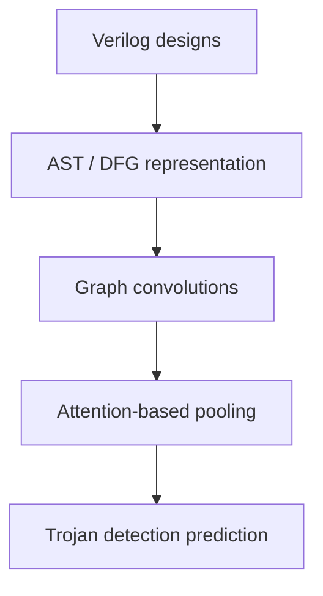
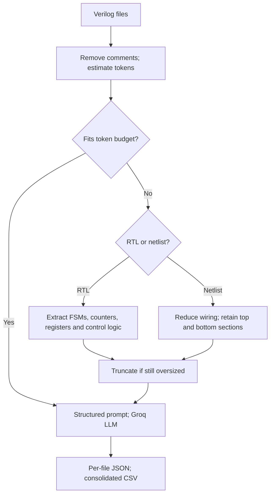

# Hardware Trojan Detection & LLM-Assisted Hardware Reverse Engineering

**Rank 1 — Innovation Challenge & Bootcamp on Hardware Security, IIT Kanpur**

**Team Trilochan:** Ansh Bhardwaj and Shresth Shankhdhar · IIIT Nagpur

[GitHub](https://github.com/SHRESTHsGIT/HT_DETECTOR) | [Technical Report](https://drive.google.com/file/d/16pw0zoNr8NeK2T7XGJrfcdJgEG2dE3VU/view?usp=sharing)

A hardware security project with two complementary workflows:

- **Graph neural network (GNN) detection** of hardware Trojans in Verilog circuit designs.
- **LLM-assisted reverse engineering** to identify circuit functionality and HDL coding style, with structured JSON analysis and consolidated CSV reports.

The project achieved first place at the IIT Kanpur Hardware Security Innovation Challenge & Bootcamp, as reported by the team.

## Results

The supplied project presentation reports evaluation on **21 designs**, with **18 correct predictions** and **3 incorrect predictions**.

| GNN detection metric | Reported result |
| --- | ---: |
| Accuracy | 85.7% |
| Precision | 92.86% |
| Recall | 86.67% |
| F1-score | 89.66% |

The presentation also reports:

- All evaluated Trojan-infected **UART_TX** designs were detected.
- Evaluated Trojan-infected **SPI master** designs were detected.
- **7 of 8 UART_RX designs** were correctly classified, including Trojan-free and infected samples.
- A final evaluation set had **3 of 5 correct predictions**; its design family is not named in the extracted presentation text.

These are historical project results, not a fresh reproduction. The evaluation is small; the figures should not be interpreted as established performance across arbitrary hardware designs. The presentation does not specify the train/test split, averaging convention, or all dataset details. The LLM analysis results are described qualitatively; no numerical LLM classification accuracy is reported.

## 1. Graph-Based Hardware Trojan Detection

### Why represent circuits as graphs?

Circuit behavior depends on relationships between signals and operations. Graph representations retain those dependencies rather than treating the design as a flat sequence of tokens or unrelated features.

### Workflow



The project uses Verilog abstract syntax tree (AST) and data-flow graph (DFG) representations, graph convolutions, and attention-based pooling, as described in the team's project summary. The presentation describes supervised graph classification trained with backpropagation.

Exact graph construction, node features, graph layer definitions, pooling configuration, and training hyperparameters should be read from the repository implementation. They are not fully specified in the presentation text and are not assumed here.

## 2. LLM-Assisted Hardware Reverse Engineering

The second workflow processes folders of Verilog files using input preparation tailored to RTL and netlist designs. It sends structured prompts to an LLM through the **Groq API**, then collects its analysis in machine-readable outputs.



### Input preparation

1. Scan a folder of Verilog files and remove comments.
2. Estimate each file's token size.
3. Analyze files within the token budget directly.
4. For oversized files, distinguish netlists from behavioral RTL.
5. Reduce redundant wiring statements in netlists, retaining top and bottom sections. For RTL, retain key semantic logic such as FSMs, counters, registers, and control logic.
6. Truncate remaining oversized inputs to fit the model's token limit.

This is a token-budget heuristic. Compression and truncation may discard useful circuit information, so model outputs should be checked against the original design.

### Analysis and reporting

The structured prompt asks the LLM to identify:

| Output | Examples / purpose |
| --- | --- |
| Hardware block type | UART, FIFO, AES |
| HDL coding style | RTL, FSM-centric, structural |
| Functional explanation | Concise explanation of the design's behavior |
| Structured results | Per-file JSON and a consolidated CSV report |

The supplied presentation describes successful identification in most evaluated cases, without a numerical accuracy breakdown. The exact LLM model identifier and token limit are not specified.

The LLM component supports design understanding. The supplied documentation does not establish that its outputs feed the GNN or that the two workflows are jointly trained.

## Technologies

| Component | Techniques / tools |
| --- | --- |
| Circuit input | Verilog / HDL, RTL, netlists |
| Graph representation | AST, DFG |
| Detection model | GNNs, graph convolutions, attention-based pooling |
| Circuit analysis | LLM prompting through Groq API |
| Input preparation | Comment removal, token estimation, RTL/netlist-specific compression |
| Reporting | JSON, CSV |
| Evaluation | Accuracy, precision, recall, F1-score |

## Repository and Reproduction

```bash
git clone https://github.com/SHRESTHsGIT/HT_DETECTOR.git
cd HT_DETECTOR
```

Use the repository's actual dependency declarations, scripts, and configuration for installation and execution. This README was prepared from the uploaded presentation and team-provided summary, rather than an inspection or execution of the source code; exact script names and commands are therefore not invented.

For reproducible experiments, record:

- Dataset sources, circuit families, labels, and separation of related circuit variants across data splits.
- AST/DFG preprocessing, node and edge features, and graph construction rules.
- Model configuration, seed, training settings, and checkpoint selection.
- Evaluation split, class counts, and metric definitions.
- Groq model identifier, prompts, token budget, compression settings, and generation parameters.

Provide Groq credentials through local configuration or environment variables and keep them out of version control.

## Limitations and Next Steps

- **Small evaluation set:** the reported detection results cover 21 designs. Broader testing across circuit families and Trojan types is needed to assess generalization.
- **Incomplete reproduction details:** the presentation does not provide all data split and training settings.
- **LLM analysis is qualitative:** quantify functionality and coding-style classification on a labeled evaluation set.
- **Compression may lose context:** evaluate compressed and full-context analysis where possible.
- **Model improvements:** the presentation proposes additional training, hyperparameter tuning, and alternative pooling strategies.

## Authors and Report

**Team Trilochan — Ansh Bhardwaj and Shresth Shankhdhar**  
Indian Institute of Information Technology, Nagpur

[Read the Technical Report](https://drive.google.com/file/d/16pw0zoNr8NeK2T7XGJrfcdJgEG2dE3VU/view?usp=sharing)

Documentation source: the uploaded 11-page presentation, *Architecture for Hardware Trojan Detection using Graph Learning*, including the *Hardware Reverse Engineering* title page, plus the team-provided project summary and competition result. No new training or evaluation was performed while preparing this README.


## References

1. [Google Scholar citation record](https://scholar.google.si/citations?view_op=view_citation&hl=ja&user=ejWHC-cAAAAJ&cstart=20&pagesize=80&citation_for_view=ejWHC-cAAAAJ:6VlyvFCUEfcC) — reference supplied by the project author.
